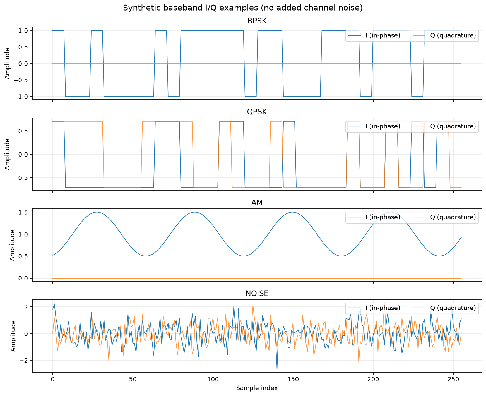
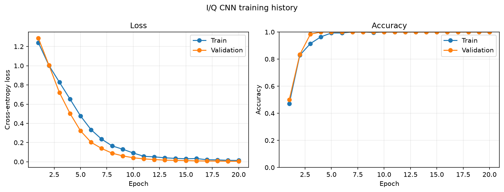
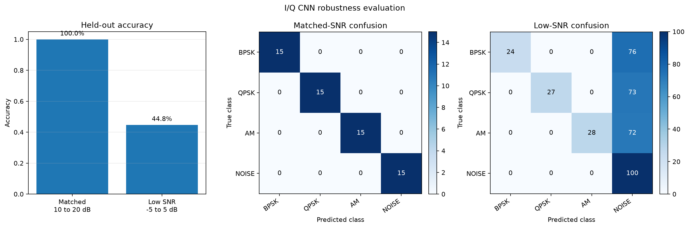

# Synthetic I/Q Signal Classification with a Lightweight 1D CNN

A CPU-friendly PyTorch project that classifies synthetic complex-baseband I/Q samples into **BPSK**, **QPSK**, **AM**, and **NOISE**. The project includes reproducible signal generation, stratified dataset preparation, a compact 1D convolutional neural network, a training pipeline, and a held-out robustness evaluation across two SNR ranges.

> **Scope:** This is a simplified synthetic baseband learning project. It is not a standards-compliant RF simulator, a software-defined radio receiver, or a hardware-validated modulation classifier.

**Repository:** [github.com/heeradeepsingh5252/iq-signal-classifier](https://github.com/heeradeepsingh5252/iq-signal-classifier)

---

## Project results at a glance

| Experiment | Evaluation samples | Measured accuracy |
|---|---:|---:|
| Matched-SNR test, 10 to 20 dB | 60 | **100.00%** |
| Independent low-SNR evaluation, -5 to 5 dB | 400 | **44.75%** |

The observed accuracy difference is **55.25 percentage points**. The low-SNR result is an important finding: the model performs very well on the held-out test set from the matched training SNR range, but many noisier BPSK, QPSK, and AM examples are classified as NOISE in the lower-SNR experiment.

These are measured results from the committed checkpoint and reports in this repository. They describe this synthetic experiment only and should not be interpreted as real-world RF performance.

## Signal classes and representation

Each example is a two-channel tensor with shape **`(2, 256)`**:

- **I:** in-phase component.
- **Q:** quadrature component.

The generator creates four classes:

| Class | Simplified synthetic representation |
|---|---|
| BPSK | Real baseband symbols selected from -1 and +1, repeated across samples; Q is zero before noise is added. |
| QPSK | I and Q symbol components independently selected from +/- 1/sqrt(2), then repeated across samples. |
| AM | A real baseband envelope `1 + 0.5*cos(...)`; Q is zero before noise is added. |
| NOISE | Complex white Gaussian noise with unit average total I/Q power and no underlying signal. |

For BPSK, QPSK, and AM, the generator samples an SNR from the configured range and adds complex Gaussian noise. The NOISE class is generated independently as noise-only data and does not receive this SNR-controlled additive-noise step.

### Example synthetic signals



## Dataset design and leakage prevention

The default experiment uses a fixed random seed (`42`) and the following data sizes:

| Split | SNR range | Samples | Samples per class |
|---|---:|---:|---:|
| Training | 10 to 20 dB | 280 | 70 |
| Validation | 10 to 20 dB | 60 | 15 |
| Matched-SNR test | 10 to 20 dB | 60 | 15 |
| Independent low-SNR evaluation | -5 to 5 dB | 400 | 100 |

The matched-SNR pool contains 100 samples per class and is split into training, validation, and test subsets. The low-SNR evaluation pool is generated separately.

A per-channel normalizer is **fitted only on the training subset**. Its saved mean and standard deviation are reused unchanged for validation, matched-SNR test, and low-SNR evaluation data. During Phase 5 evaluation, the saved checkpoint configuration is used to regenerate the deterministic splits, and the regenerated normalizer is checked against the values stored in the checkpoint.

The training loop iterates only over the training and validation loaders. The matched-SNR test and low-SNR evaluation loaders are reserved for the separate evaluation step.

## Model architecture

The classifier is a small 1D CNN that accepts two-channel I/Q sequences and returns four class logits.

| Stage | Layer configuration |
|---|---|
| Input | `(batch, 2, 256)` |
| Convolution block 1 | `Conv1d(2, 16, kernel_size=7)` + BatchNorm + ReLU + MaxPool(2) |
| Convolution block 2 | `Conv1d(16, 32, kernel_size=5)` + BatchNorm + ReLU + MaxPool(2) |
| Convolution block 3 | `Conv1d(32, 64, kernel_size=3)` + BatchNorm + ReLU |
| Pooling | Adaptive average pooling to length 1 |
| Classifier head | Flatten + Linear(64, 32) + ReLU + Dropout(0.2) + Linear(32, 4) |
| Output | Four raw logits in the order BPSK, QPSK, AM, NOISE |

**Trainable parameters:** 11,364.

The model returns logits rather than probabilities so they can be passed directly to `torch.nn.CrossEntropyLoss`. Softmax is available for inference when class probabilities are needed.

## Training configuration and observed training results

The committed Phase 4 run used:

| Setting | Value |
|---|---:|
| Device | CPU |
| PyTorch threads | 1 |
| Maximum epochs | 20 |
| Batch size | 32 |
| Optimizer | AdamW |
| Learning rate | 0.001 |
| Weight decay | 0.0001 |
| Early-stopping patience | 5 epochs |
| Random seed | 42 |
| Checkpoint selection | Lowest validation loss |

The best checkpoint was saved at **epoch 20**, with:

- **Best validation loss:** `0.0050479`
- **Best validation accuracy:** `100.00%`
- **Training accuracy at epoch 20:** `100.00%`
- **Training loss at epoch 20:** `0.0139090`

Validation accuracy first reached 100% at epoch 4. Validation loss continued to improve through epoch 20, so the run completed all 20 epochs without triggering the patience-based early-stopping condition. The checkpoint was selected using validation loss, not matched-test or low-SNR evaluation performance.

### Training curves



## Held-out evaluation and robustness results

Phase 5 loads the saved `models/iq_classifier.pt` checkpoint and performs inference only. It does not retrain the model or fit normalization statistics on the evaluation data.

### Overall accuracy

| Evaluation | SNR range | Samples | Accuracy |
|---|---:|---:|---:|
| Matched-SNR test | 10 to 20 dB | 60 | **100.00%** |
| Independent low-SNR evaluation | -5 to 5 dB | 400 | **44.75%** |

**Matched minus low-SNR accuracy:** `55.25` percentage points.

### Per-class metrics

Precision, recall, and F1-score are calculated per class. Values below are from the committed `reports/robustness_results.json`.

| Class | Matched precision | Matched recall | Matched F1 | Low-SNR precision | Low-SNR recall | Low-SNR F1 |
|---|---:|---:|---:|---:|---:|---:|
| BPSK | 1.0000 | 1.0000 | 1.0000 | 1.0000 | 0.2400 | 0.3871 |
| QPSK | 1.0000 | 1.0000 | 1.0000 | 1.0000 | 0.2700 | 0.4252 |
| AM | 1.0000 | 1.0000 | 1.0000 | 1.0000 | 0.2800 | 0.4375 |
| NOISE | 1.0000 | 1.0000 | 1.0000 | 0.3115 | 1.0000 | 0.4751 |

### Confusion matrices

Rows are true labels and columns are predicted labels. Class order is **BPSK, QPSK, AM, NOISE**.

**Matched-SNR test**

```text
[[15,  0,  0,  0],
 [ 0, 15,  0,  0],
 [ 0,  0, 15,  0],
 [ 0,  0,  0, 15]]
```

**Independent low-SNR evaluation**

```text
[[24,  0,  0, 76],
 [ 0, 27,  0, 73],
 [ 0,  0, 28, 72],
 [ 0,  0,  0, 100]]
```

The principal low-SNR error pattern is that modulated signals are predicted as NOISE: 76 of 100 BPSK examples, 73 of 100 QPSK examples, and 72 of 100 AM examples were classified as NOISE. The model correctly identified all 100 noise-only examples in this evaluation set. This explains the combination of high precision but low recall for the three modulated classes, and low precision but full recall for NOISE.

### Robustness comparison chart



### Important interpretation note

The NOISE class is generated independently of the SNR range. Consequently, the low-SNR experiment applies the changed additive-noise condition to BPSK, QPSK, and AM, but does not create a separate SNR-shifted NOISE class. Interpret the comparison with that generator design in mind.

## Repository structure

```text
.
├── docs/
│   └── screenshots/
│       ├── signal-examples.png
│       ├── training-curve.png
│       └── robustness-comparison.png
├── models/
│   └── iq_classifier.pt
├── reports/
│   ├── training_history.json
│   ├── robustness_results.json
│   └── robustness_summary.md
├── scripts/
│   ├── inspect_dataset.py
│   └── plot_examples.py
├── src/iq_signal_classifier/
│   ├── __init__.py
│   ├── signal_gen.py
│   ├── dataset.py
│   ├── model.py
│   ├── train.py
│   └── evaluate.py
├── tests/
│   ├── test_signal_gen.py
│   ├── test_dataset.py
│   ├── test_model.py
│   ├── test_train.py
│   └── test_evaluate.py
├── requirements.txt
└── requirements-dev.txt
```

## Setup

The project was run in a macOS environment with Python 3.13.17. Python 3.11 or newer is recommended.

```bash
git clone https://github.com/heeradeepsingh5252/iq-signal-classifier.git
cd iq-signal-classifier

python3 -m venv .venv
source .venv/bin/activate

python -m pip install --upgrade pip
python -m pip install -r requirements.txt
python -m pip install -r requirements-dev.txt
python -m pip check
```

The dependency versions are pinned in `requirements.txt` and `requirements-dev.txt`.

## Reproduce the project

Run commands from the repository root with the virtual environment activated.

### 1. Generate example signals

```bash
PYTHONPATH=src python scripts/plot_examples.py
```

### 2. Inspect the dataset splits

```bash
PYTHONPATH=src python scripts/inspect_dataset.py
```

### 3. Train the CNN

The committed checkpoint was produced with this command:

```bash
PYTHONPATH=src python -m iq_signal_classifier.train \
  --epochs 20 \
  --patience 5 \
  --batch-size 32 \
  --n-per-class 100
```

This writes:

- `models/iq_classifier.pt`
- `reports/training_history.json`
- `docs/screenshots/training-curve.png`

### 4. Evaluate matched-SNR and low-SNR performance

```bash
PYTHONPATH=src python -m iq_signal_classifier.evaluate \
  --checkpoint models/iq_classifier.pt \
  --output-dir . \
  --batch-size 32
```

This writes:

- `reports/robustness_results.json`
- `reports/robustness_summary.md`
- `docs/screenshots/robustness-comparison.png`

### 5. Run tests and lint checks

```bash
PYTHONPATH=src python -m pytest -q tests
python -m ruff check src tests
python -m compileall -q src tests scripts
```

**Verified project checks:** 26 tests passed; Ruff reported `All checks passed!` after the Phase 5 lint fix. The actual test run reported by the project owner was `26 passed`.

## Limitations

- **Synthetic data only:** the signals are generated by simplified mathematical functions. No external RF dataset or SDR hardware was used.
- **Simplified signal models:** pulse shaping, carrier frequency and phase offsets, timing errors, filtering, multipath fading, Doppler, receiver effects, and other hardware/channel impairments are outside the current simulation.
- **SNR scope:** the low-SNR shift affects BPSK, QPSK, and AM. The noise-only class is independent of the SNR parameter.
- **Generalization:** the 100% matched-SNR test result is based on 60 synthetic examples. It does not establish real-world generalization. The low-SNR result demonstrates a substantial performance drop under the tested synthetic condition.
- **No deployment claim:** this repository contains an offline training and evaluation workflow, not a production RF service or hardware integration.

## Next experiments

Potential next steps, not yet implemented or measured:

1. Train with SNR augmentation that covers a wider range, then compare on a fixed untouched low-SNR test set.
2. Report accuracy and per-class recall across narrower SNR buckets instead of one combined low-SNR range.
3. Add more realistic impairments such as phase/frequency offsets, timing offsets, fading, and filtering.
4. Validate on captured I/Q data from a suitable public dataset or SDR hardware before making real-world performance claims.

## Interview explanation

**What does the project do?**  
It generates synthetic two-channel I/Q baseband samples for BPSK, QPSK, AM, and noise-only classes, trains a compact 1D CNN, and evaluates performance on matched and lower SNR ranges.

**Why use a 1D CNN?**  
The input is a time-ordered I/Q sequence. One-dimensional convolutions learn local patterns across time while keeping the model small. This implementation has 11,364 trainable parameters.

**How did you avoid data leakage?**  
The matched-SNR pool is split into training, validation, and test subsets. The channel normalizer is fitted only on the training subset. A separate low-SNR pool is generated for evaluation and is not used for training or checkpoint selection.

**Why is validation accuracy 100% but low-SNR accuracy 44.75%?**  
The validation set uses the matched 10 to 20 dB SNR range. The independent low-SNR evaluation uses -5 to 5 dB. Under that noisier condition, many modulated examples are predicted as NOISE. The result indicates a robustness weakness in this synthetic experiment.

**What would you improve next?**  
I would add broader SNR augmentation and more realistic signal/channel impairments, then evaluate on fixed held-out SNR buckets. I would report improvements only if the new evaluation supports them.

---

## Artifacts

- [Trained model checkpoint](models/iq_classifier.pt)
- [Training history](reports/training_history.json)
- [Robustness metrics (JSON)](reports/robustness_results.json)
- [Robustness report (Markdown)](reports/robustness_summary.md)
- [Phase 5 evaluation implementation](src/iq_signal_classifier/evaluate.py)

